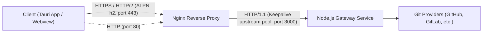

# Docker Deployment Guide

This project is fully self-hosted and can be deployed on any server with Docker and Docker Compose installed, without any dependency on Vercel.

---

## Architecture Overview

The stack is orchestrated using `compose.yml` and consists of two services in an isolated bridge network:



1. **`git-gateway`**:
   - Node.js runtime (v24 alpine, multi-stage build).
   - Express HTTP server ([`src/server.ts`](../src/server.ts)) bundled with `tsup`.
   - Runs as a non-root `node` user for improved security.
   - Internal port: `3000`.
   - Built-in health check endpoint: `GET /health`.

2. **`nginx`**:
   - Lightweight `nginx:alpine` reverse proxy.
   - Public ports: `80` (HTTP) and `443` (HTTPS with **HTTP/2** enabled via `http2 on;`).
   - Upstream pool to `git-gateway` using persistent `keepalive 32` connections over HTTP/1.1 for minimal latency.
   - Configured to pass client headers (`X-Real-IP`, `X-Forwarded-*`, `X-Update-Channel`, `X-App-Language`, `X-Framework-Version`).
   - Extended timeouts and tuned proxy buffers for streaming large binary files (`/api/v1/download`, `/api/v1/file`).

---

## Quick Start

### 1. Configure Environment Variables

Copy the example configuration file:

```bash
cp .env.example .env
```

Edit `.env` to configure your Git provider and repository settings:

```env
# Choose provider: github | gitlab | gitea
PROVIDER_TYPE=github

# Repository configuration
REPO_OWNER=your-org-or-username
REPO_NAME=your-private-repo
REPO_BRANCH=main

# Personal Access Token (PAT) with read access to releases and contents
GITHUB_TOKEN=ghp_xxxxxxxxxxxx
```

### 2. SSL Certificates (for HTTP/2)

HTTP/2 requires TLS/SSL certificates (`fullchain.pem` and `privkey.pem`) located in `docker/certs/`.

#### Option A: Local Testing / Development (Self-Signed)

Generate a self-signed certificate:

```bash
openssl req -x509 -nodes -days 365 -newkey rsa:2048 \
  -keyout docker/certs/privkey.pem \
  -out docker/certs/fullchain.pem \
  -subj "/CN=localhost"
```

#### Option B: Production (Let's Encrypt / Certbot)

Copy or symlink your production certificates into `docker/certs/`:

```bash
cp /etc/letsencrypt/live/your-domain.com/fullchain.pem docker/certs/
cp /etc/letsencrypt/live/your-domain.com/privkey.pem docker/certs/
```

_(Or mount the Let's Encrypt directory directly in `compose.yml`)_

### 3. Build and Start the Containers

Launch the stack in detached mode:

```bash
docker compose up -d --build
```

### 4. Check Service Status & HTTP/2 Verification

Verify that both containers are running and healthy:

```bash
docker compose ps
```

Verify **HTTP/2** over HTTPS:

```bash
curl -kI https://localhost/health
```

Output will indicate `HTTP/2 200`:

```text
HTTP/2 200
server: nginx/...
content-type: application/json; charset=utf-8
```

View aggregated logs:

```bash
docker compose logs -f
```

---

## Useful Commands

- **Stop the stack**:

  ```bash
  docker compose down
  ```

- **Restart the gateway service after editing `.env`**:

  ```bash
  docker compose up -d git-gateway
  ```

- **Rebuild images when updating the source code**:
  ```bash
  docker compose build --no-cache
  docker compose up -d
  ```
